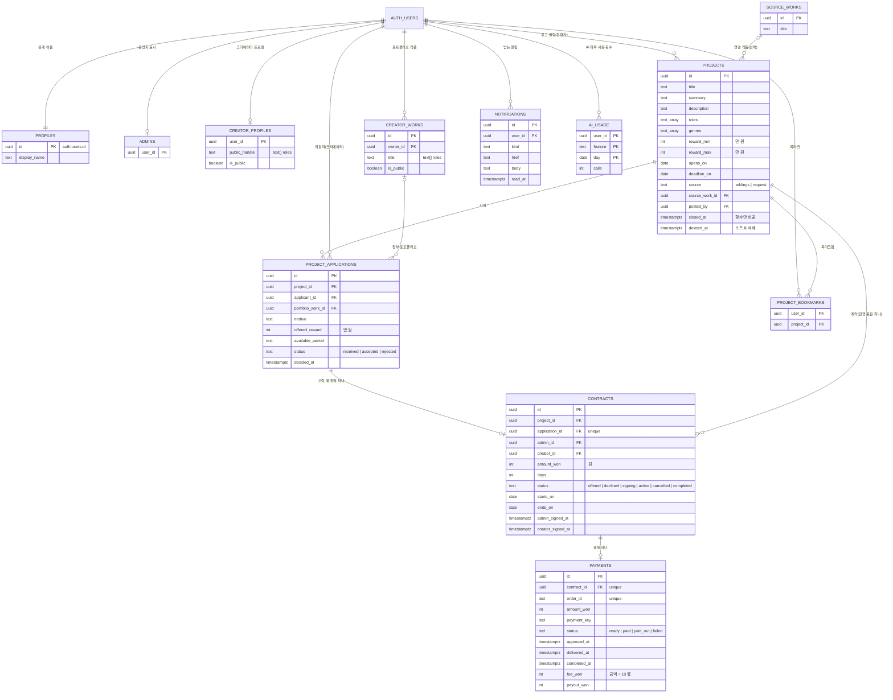

# 팀 미션(WorkBridge 기준) ERD — 아클링스 「프로젝트」·계약·결제

팀 미션 공고가 요구하는 ERD(표 관계도)다. 공고의 8개 핵심 데이터(사용자·프로필·프로젝트·지원·알림·북마크·계약·결제)를 아클링스 표에 맞춰 그렸다.
리뷰(공고 3.7)는 만들지 않았으므로 표가 없다. 기준 SQL: `supabase/migrations/0002`, `0003`, `0010`대(크리에이터), `0017`, `0029`~`0035`.

## 관계도

## 상태 흐름

| 대상 | 흐름 |
|---|---|
| 공고 | 모집 중(`closed_at` 비어 있음) → 마감(수락·직접 마감·마감일 지남). 계약이 거부·취소되면 다시 모집 중 |
| 지원 | `received` → `accepted` 또는 `rejected`. 한 공고에 수락은 하나. 수락하면 나머지 접수 지원은 자동 거절 |
| 계약 | `offered` → `signing`(동의) 또는 `declined`(거부) → `active`(양측 서명) → `completed`(완료 승인). 체결 전에는 `cancelled` 가능 |
| 결제 | `ready`(주문 저장) → `paid`(토스 승인) → `paid_out`(완료 승인·정산 기록). 실패하면 `failed`, 새 주문번호로 다시 `ready` |

## 권한 원칙
- 화면(브라우저)은 표를 읽기만 하고, 상태 변경은 DB 처리 함수(security definer)로만 한다.
- 공고 쓰기·지원 처리·결제 주문·완료 승인은 운영자(`is_admin()`)만, 지원·동의·납품 요청은 본인만 한다.
- 계약·결제는 당사자(크리에이터 본인과 운영자)만 읽는다. 알림·북마크는 본인만 읽는다.
